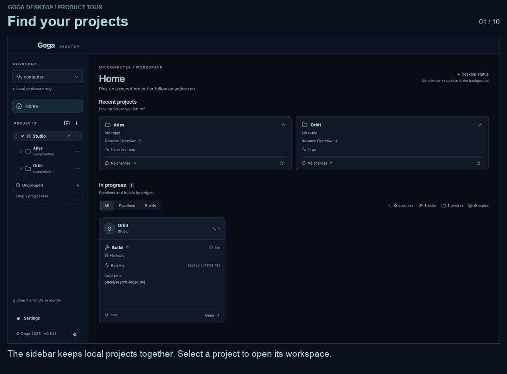

# Goga Desktop

Goga Desktop is a macOS app for running [Goga](https://github.com/qarium/goga) pipelines in local projects. Open a folder, choose a pipeline and its stages, then follow the run without leaving the app. Desktop provides the interface; the Goga CLI runs the pipeline using Docker.

<picture>
  <source media="(prefers-reduced-motion: reduce)" srcset="guides/media/desktop-tour-poster.png">
  
</picture>

*Sample projects, simulated run. Recorded in English with a disposable project. [How the tour is recorded](guides/readme-tour.md).*

## What you can do

- **Work with code and specifications.** Browse the file tree, edit project files, inspect the architecture graph and read project documentation in **Project → Usages**.
- **Keep work separate.** Use the original project folder, or give a Git topic its own working copy. Track topics in a table or on a board.
- **Run pipelines and builds.** Choose a workflow, profile and stages; follow progress in the run tab and revisit logs in **Runs**.
- **Work across projects.** Add projects to the sidebar, group them by team or product, and see their active runs on **Home**.
- **Show a prototype.** Open a web page in an isolated demonstration tab and optionally let a trusted local agent control it.

## 1. Install Goga Desktop

1. Open [GitHub Releases](https://github.com/qarium/goga-desktop/releases/latest). Download the DMG for your Mac and the accompanying `SHA256SUMS`. Choose **arm64** for Apple Silicon or **x64** for Intel; **About This Mac** shows which chip you have.
2. In Terminal, run `shasum -a 256` followed by a space and the downloaded DMG's path (you can drag the file into Terminal). The result must match the hash next to that filename in `SHA256SUMS`. If it doesn't, don't open the file.
3. Open the DMG, drag **Goga Desktop** to **Applications**, and open it from there.

The builds are ad hoc signed, not signed with an Apple Developer ID or notarized. Gatekeeper may block the download. If your Mac does not allow the app to open, do not disable its security protections.

English is the default interface language. To use Russian, open **Settings → General → Language** and choose **Русский**. The change takes effect immediately and is remembered across projects and restarts. It does not change project files or command output.

## 2. Prepare to run a pipeline

Desktop does not bundle the Goga CLI or Docker. Install [pipx](https://pipx.pypa.io/stable/how-to/install-pipx.html) if needed, then run:

```sh
pipx install goga
goga --version
```

Install and start [Docker Desktop for Mac](https://docs.docker.com/desktop/setup/install/mac-install/) or use your existing Docker installation. Run `docker info` in Terminal: it should show **Server** information, not a connection error. If your pipeline uses an AI agent, [configure the agent's credentials for the container](https://qarium.github.io/goga/features/pipelines/runtime/#credentials); a login on the host is not automatically available inside it.

**Git is optional for a run without a topic.** You need it to clone a repository or use topic working copies.

## 3. Open and configure a project

Click **+** next to **Projects** in the sidebar:

- **Already have a Goga project?** Choose **Open existing…** and select the project root. To start from a remote Git repository, choose **Create new… → From a Git repository** instead.
- **Starting in an empty folder?** Choose **Create new… → From scratch**. Git initialization is on by default; turn it off if you don't need topics. In the new project's **Terminal** tab, run `goga init` and follow the prompts. This creates the Goga configuration; creating a folder or Git repository alone does not. Skip this step for an already configured project. See the [Goga quick start](https://github.com/qarium/goga#quick-start) for details.

To keep related projects together, use the folder-with-plus button beside **Projects** to create a group. Open a project’s **…** menu and choose the group to move it there. Grouping changes the sidebar, not the folder on disk.

Open **Project → Launch**. Under **Goga → Executable**, keep `goga` if it is on your path. If it works in Terminal but Desktop cannot find it, run `command -v goga` in Terminal and paste the absolute path to the executable into the field, without arguments. Leave **Default profile** on **Automatic** unless the project calls for a specific profile. Save any changes.

## 4. Launch your first pipeline

1. For a first try, use a sample project and leave the header selector on **No topic**. The pipeline will work in the original folder, not in a disposable copy.
2. Open **Launch** in the top right. **Pipeline** runs a set of stages, **Build** runs a build plan, and **Start demonstration** opens a web page. Choose **Pipeline**, then select `refinement` if available. The tour shows its four stages: `define`, `discover`, `specify`, and `review`. Check the workflow, profile, and stages for your own run. Opening the form does not start it.
3. Click **Launch** at the bottom of the form. Follow progress in the run tab. To come back later, open **Runs** in the same project and topic context.

If no pipelines appear, check that you opened the project root, that Goga is configured there, and that the executable in **Project → Launch** matches the one you tested. If a pipeline fails after launch, start with its output log.

## Guides

[Workspaces, topics, files and runs](guides/workspaces.md) · [Demonstrations and agent connections](guides/demonstrations.md) · [Working on Goga Desktop](AGENTS.md)
